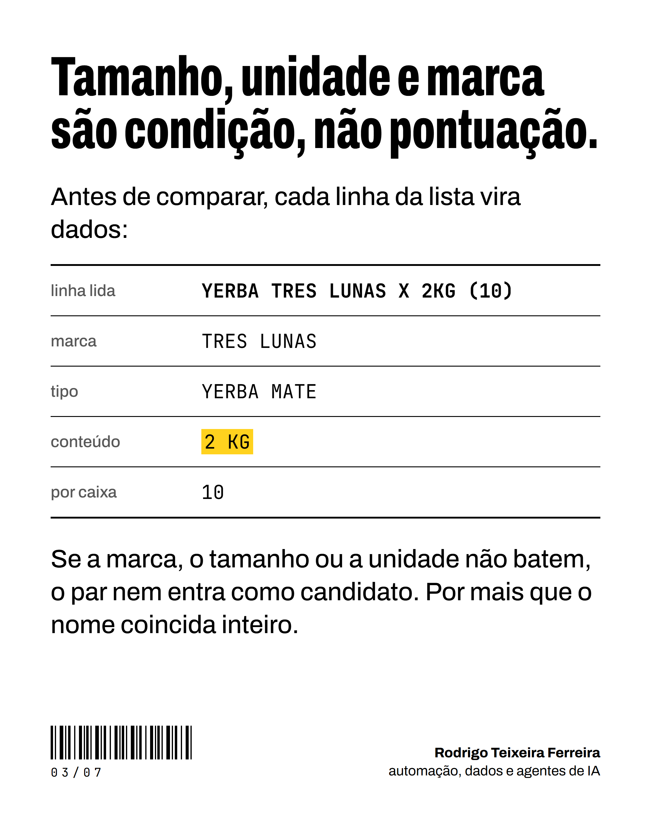
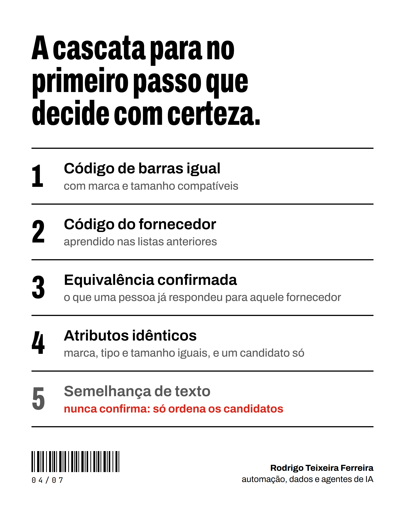

# 1. A cascata de identificação

A pergunta que o sistema responde para cada linha de cada lista: **esta oferta é qual produto do cadastro da loja?**
A resposta errada custa mais que a falta de resposta, porque compara o preço de dois produtos diferentes.

## Antes de comparar, a linha vira dados

O extrator lê o texto cru e devolve atributos. Exemplo com marca fictícia:

| | |
|---|---|
| linha lida | `YERBA TRES LUNAS X 2KG (10)` |
| marca | TRES LUNAS |
| tipo | YERBA MATE |
| conteúdo | 2 KG |
| por caixa | 10 |

Regras de leitura que evitam os erros mais comuns:

- a marca se compara pela forma canônica (duas grafias da mesma marca são a mesma marca);
- o tamanho de um pack inclui quantas unidades ele tem: o pack de 4 não é a garrafa avulsa;
- a quantidade lida dos dois lados se converte: uma caixa de 60 unidades são 15 packs de 4. A conversão nunca é
  adivinhada;
- variedade contraditória não confirma: pão de cachorro-quente não é pão de hambúrguer.

## A cascata

Roda no banco, em SQL, e para no primeiro passo que decide com certeza.

1. **Código de barras igual**, com marca e tamanho compatíveis.
2. **Código do fornecedor** aprendido nas listas anteriores.
3. **Equivalência confirmada:** o que uma pessoa já respondeu para aquele fornecedor.
4. **Atributos idênticos e um candidato só.**
5. **Semelhança de texto:** nunca confirma. Só ordena os candidatos para a revisão.

## A palavra que sobra

Sem código de barras, a regra mais importante: **toda palavra que aparece de um lado só precisa ser ruído declarado
no vocabulário**, ou o par não confirma. Ela derrubou 365 pares que pareciam certos, e nenhum falso positivo
sobreviveu à auditoria seguinte.

O vocabulário também foi conferido fora de casa: cada termo que afirma que dois textos são o mesmo produto precisou
de duas fontes independentes ou de três pares já confirmados. De 732 afirmações, 3 eram falsas. O termo falso se
desativa, nunca se apaga, e o par que dependia só dele volta a ser pergunta.

## O nível de certeza

| Nível | Como se provou | Conta como confirmado |
|---|---|---|
| 1 | decisão humana | sim |
| 2 | código de barras | sim |
| 3 | regra forte: todas as palavras casam, candidato único, preço coerente com o custo | sim |
| 4 | regra média ou resposta da IA que não chega ao nível 3 | não: vai à revisão |

## Identidade e preço são duas perguntas

O custo do cadastro serve de trava de plausibilidade: um preço muito longe dele sugere erro de leitura (a caixa lida
como unidade, o imposto que faltou). Mas a trava não desfaz a identidade. O produto identificado continua
identificado; a linha com o preço suspeito só não compete até alguém responder «o preço está certo» ou «foi mal lido».
