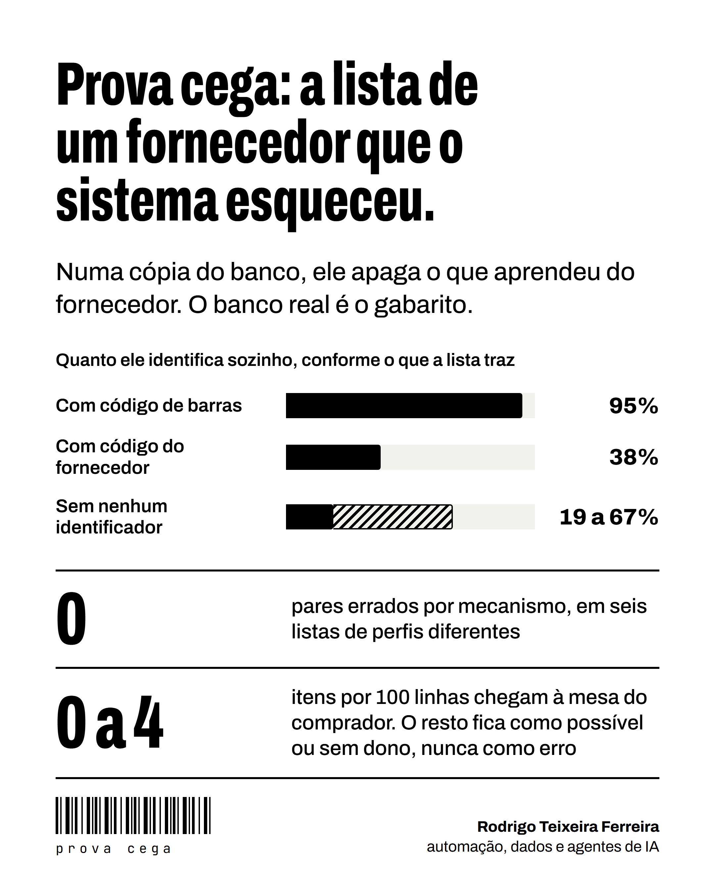

# 3. A prova cega: o fornecedor que o sistema nunca viu

Testar com listas novas de fornecedores conhecidos é o caso fácil: o sistema já aprendeu as abreviaturas, os códigos
e o formato de cada um. A pergunta que importa para a manutenção é outra: **o que acontece quando chega um
fornecedor novo?**

## O desenho

Numa cópia do banco, o sistema **esquece tudo o que aprendeu de um fornecedor** e recebe a lista dele como nova.
O banco real, com as decisões humanas, é o gabarito.

Seis listas de perfis diferentes passaram pelo caminho inteiro, sem mão: com código de barras, com código do
fornecedor, sem nenhum identificador, uma grande (2.611 linhas) e uma em imagem.

## O resultado

| Medida | Valor |
|---|---|
| Pares errados por mecanismo | 0 |
| Identificado sozinho, com código de barras | 95% |
| Identificado sozinho, com código do fornecedor | 38% |
| Identificado sozinho, sem identificador | de 19% a 67%, conforme a lista |
| Itens que chegam à mesa do comprador | de 0 a 4 por 100 linhas |

O que não se identifica fica como «possível» ou «sem dono». Nunca como erro.

A lista do mês seguinte do mesmo fornecedor, com 10% de produtos novos, se resolve quase sozinha. A manutenção de um
mês com vinte listas renovadas é de dezenas de linhas, não de centenas.

## O que a prova pediu

Todas as correções foram gerais e entraram com teste. Exemplos:

- a linha nova e forte de um fornecedor passou a ganhar cartão de revisão (as perdidas caíram de 36 para 14 numa
  lista e de 15 para 3 em outra);
- o filtro final deixou de repetir o que já decidiu ou o que está em curso;
- a lista lida pela IA passou a usar o cabeçalho da seção como marca.

## Sem IA, o mesmo zero

A prova foi refeita só com o que o sistema já sabe, em Python: as equivalências de escrita de cada fornecedor,
tiradas dos pares confirmados, e um índice com todos os nomes conhecidos de cada produto trazem candidatos; quem
decide continua sendo a comparação de sempre. Nenhum par errado. A régua obrigou a endurecer a regra quatro vezes:
cada «não é» errado contra o gabarito virou regra.

A prova ficou permanente e roda de novo a cada mudança.
